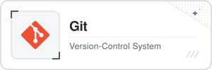

# Hi, I'm 1harvester

<strong>Aspiring Web Developer | Learning Full-Stack Development</strong>

Building web interfaces and learning front-end fundamentals while steadily expanding across the stack.

---

## 「 ABOUT ME 」

I am an aspiring developer working toward full-stack proficiency, with a current focus on modern front-end development. I am interested in building accessible, responsive user interfaces while strengthening my core web fundamentals through hands-on practice and practical projects.

---

## 「 TECH STACK 」

  
  &nbsp;
  
  &nbsp;
  

  
  &nbsp;
  
  &nbsp;
  

  
  &nbsp;
  
  &nbsp;
  

  
  &nbsp;
  
  &nbsp;
  

  

